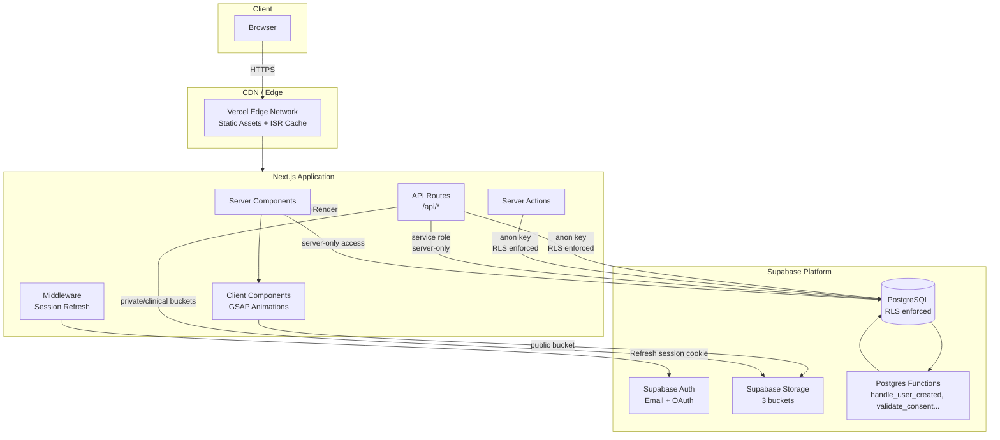
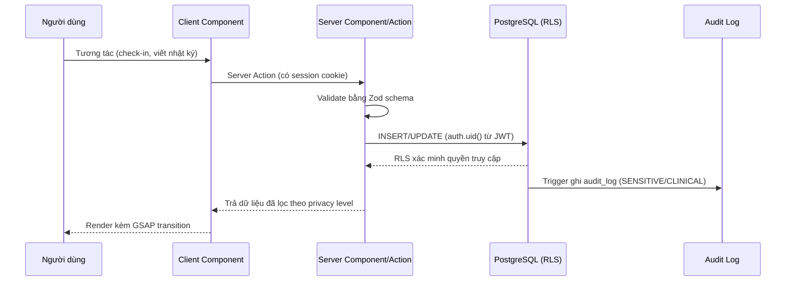
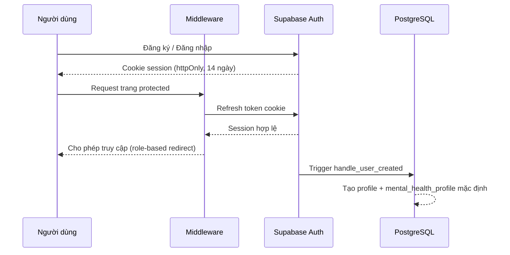
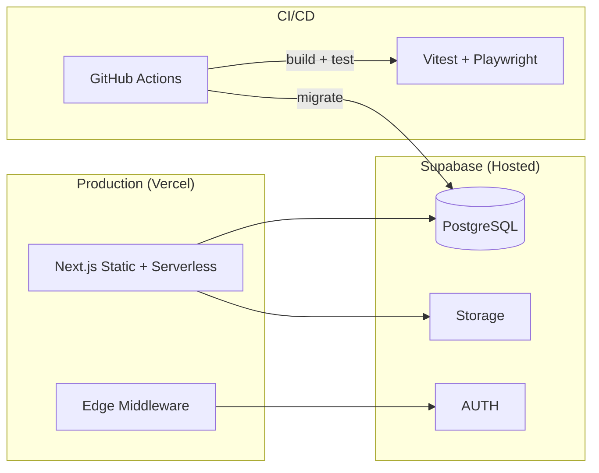

# Kiến Trúc Hệ Thống — Trạm Dừng Tâm Hồn

> Nguyên tắc: **Security > Privacy > UX > Performance**
>
> Phiên bản: 1.0.0 · Cập nhật: 2026-08-30

## 1. Tổng quan

Trạm Dừng Tâm Hồn là nền tảng sức khỏe tinh thần ưu tiên quyền riêng tư. Hệ thống được xây dựng trên **Next.js 14 (App Router)** làm frontend + backend, **Supabase** (PostgreSQL, Auth, Storage) làm nền tảng dữ liệu, triển khai trên **Vercel**.

## 2. Sơ đồ kiến trúc tổng thể

## 3. Các boundary (Phân định bảo mật)

| Boundary | Mô tả | Biện pháp |
|---|---|---|
| **Client ↔ Server** | Mọi dữ liệu nhạy cảm không bao giờ chạm client | Server Components + Server Actions cho CLINICAL/SENSITIVE data |
| **Server ↔ Supabase** | Chỉ server được dùng `service_role` key | `SUPABASE_SERVICE_ROLE_KEY` chỉ tồn tại trong `.env` server-side |
| **Postgres RLS** | Tuyến phòng thủ cuối cùng | Mọi bảng đều bật RLS; policy theo `auth.uid()` |
| **Storage** | Bucket riêng tư, signed URL ngắn hạn | Policy theo owner; `6h` expiry cho signed URLs |
| **Middleware** | Không chứa logic nhạy cảm | Chỉ refresh session, không đọc dữ liệu |

## 4. Data flow

### 4.1 Luồng xác thực (Auth)

### 4.2 Luồng dữ liệu health (nhạy cảm)

1. User gửi mood entry qua Server Action.
2. Server Action validate bằng `zod` (max length, enum, XSS sanitize).
3. Query chạy với anon key + RLS → chỉ khi `auth.uid() = user_id`.
4. Trigger ghi vào `audit_logs` cho CLINICAL/SENSITIVE.
5. Kết quả trả về chỉ gồm PRIVATE fields đã được phép.

## 5. Classification dữ liệu

| Level | Ví dụ | Truy cập |
|---|---|---|
| **PUBLIC** | Tên hiển thị, story đã public, số lượng bài | Mọi người (approve trước) |
| **PRIVATE** | Email, journal, mood entries | Owner + cấp phép khẩn |
| **SENSITIVE** | Hồ sơ sức khẩn, medications | Owner + professional có consent |
| **CLINICAL** | Clinical notes, appoitments | Owner + professional có consent + audit log |

## 6. Chi tiết các thành phần

### 6.1 Frontend (Client Components)
- **Framework**: React 18, `"use client"` components.
- **Animations**: GSAP + `useGSAP()` (`@gsap/react`), ScrollTrigger cho scroll-driven UX, `prefers-reduced-motion` tôn trọng qua `gsap.matchMedia()`.
- **Styling**: Tailwind CSS + shadcn/ui (CVA + tailwind-merge).

### 6.2 Backend (Server)
- **Server Components**: render dữ liệu PRIVATE trực tiếp, không lộ qua JS bundle.
- **Server Actions**: mutation an toàn, validate đầu vào.
- **API Routes**: endpoints công khai / webhook, rate-limited.

### 6.3 Database (Supabase PostgreSQL)
- 12+ bảng, đầy đủ RLS (xem [DATABASE.md](./DATABASE.md)).
- Migration: `supabase/migrations/0001..0006`.
- Functions: `handle_user_created`, `validate_consent`, `update_audit_log`, `calculate_mood_trends`.

### 6.4 Storage
| Bucket | Access | Policy |
|---|---|---|
| `public-assets` | Public read | Ảnh cover story, avatar |
| `private-user-data` | Owner write | Nhật ký attachments |
| `clinical-files` | Owner + professional | File hồ sơ kèm audit |

## 7. Deployment architecture

Xem [DEPLOYMENT.md](./DEPLOYMENT.md). Tóm tắt:

## 8. Security boundaries cụ thể

1. **Service role key**: chỉ dùng trong Server-only contexts (đoạn code có `import 'server-only'` hoặc nằm trong Server Components/Actions). Không bao giờ `NEXT_PUBLIC_`.
2. **RLS mọi nơi**: kể cả service role, các hàm DB critical kiểm tra `auth.uid()`.
3. **Audit log**: bảng `audit_logs` append-only (trigger chặn UPDATE/DELETE).
4. **Validation**: Zod schemas ở `src/schemas/*`, sanitize XSS ở `src/lib/security/sanitize.ts`.
5. **Rate limiting**: giới hạn auth endpoints (xem [SECURITY.md](./SECURITY.md)).
6. **HTTP Headers**: CSP, HSTS, X-Frame-Options, nosniff (xem `next.config.ts`).

## 9. Quyết định kiến trúc (ADR tóm tắt)

| Quyết định | Lựa chọn | Lý do |
|---|---|---|
| App Router vs Pages | App Router | Server Components → dữ liệu PRIVATE không vào client bundle |
| Server Actions vs API-only | Server Actions cho mutations | Type-safe, giảm attack surface |
| RLS là lớp bảo vệ cuối | Enforced RLS + service role tối thiểu | Defense in depth |
| GSAP cho animation | GSAP + ScrollTrigger | Timeline + scroll-linked UX, reduced-motion support |
| Tailwind + shadcn/ui | CSS tokens trong TS | Design system nhất quán, type-safe |