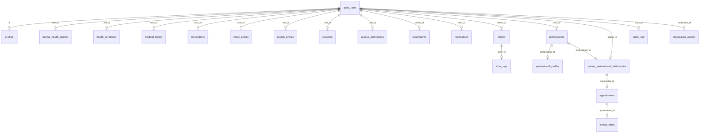

# Database Design — Trạm Dừng Tâm Hồn

> Phiên bản: 1.0.0 · Cập nhật: 2026-08-30 · Postgres 15 + Supabase

## 1. Tổng quan

Mọi dữ liệu đều nằm trong 1 PostgreSQL database trên Supabase, được bảo vệ bởi **Row Level Security (RLS)**. Không có ngoại lệ: **bảng nào cũng bật RLS**.

Migrate: `supabase/migrations/0001..0006` (chạy theo thứ tự).

## 2. ER Diagram

## 3. Bảng & vai trò

| Bảng | Mục đích | Quan trọng |
|---|---|---|
| `profiles` | Hồ sơ công khai/riêng tư cơ bản | Tự tạo bởi trigger `handle_user_created` |
| `mental_health_profiles` | Thông tin sức khỏe tinh thần (SENSITIVE) | 1-1 với user |
| `health_conditions` / `medical_history` / `medications` | Dữ liệu lâm sàng tự khai | Owner-only |
| `mood_entries` | Check-in cảm xúc (1 dòng/ngày, unique `user_id+entry_date`) | Mood tracker |
| `journal_entries` | Nhật ký riêng tư | PRIVATE mặc định |
| `stories` / `story_tags` | Câu chuyện cộng đồng | Cần duyệt trước khi public |
| `professionals` / `professional_profiles` | Chuyên gia | Verified trước |
| `patient_professional_relationships` | Quan hệ bệnh nhân–chuyên gia | Consent required |
| `appointments` | Lịch hẹn | Patient/professional |
| `clinical_notes` | Ghi chú lâm sàng (CLINICAL) | Audit log bắt buộc |
| `access_permissions` | Quyền truy cập cấp cho grantee | Grant/revoke |
| `consents` | Consent của người dùng | 6 loại |
| `audit_logs` | Nhật ký truy cập append-only | Không UPDATE/DELETE |
| `moderation_actions` | Hành động moderation | Moderator/admin |
| `notifications` | Thông báo | Owner read |
| `attachments` | Metadata file trong Storage | Liên kết bucket |

## 4. Data classification (Task 2.2)

| Level | Bảng/Field | Truy cập |
|---|---|---|
| **PUBLIC** | `stories` (is_approved), story_tags, professional_profiles | Mọi người |
| **PRIVATE** | `profiles` (display_name, bio), mood_entries, journal_entries | Owner |
| **SENSITIVE** | `mental_health_profiles`, medications, health_conditions | Owner + professional (consent) |
| **CLINICAL** | `clinical_notes`, appointments (notes) | Professional + patient + audit |

Mặc định mọi field mới là PRIVATE; chỉ nâng thành PUBLIC khi có lý do rõ ràng + kiểm duyệt.

## 5. RLS policies (tóm tắt)

Helper:
- `public.has_role(role)` — kiểm tra role từ `profiles`.
- `auth.uid()` làm identity chuẩn (không dùng `auth.jwt()` hạn chế).

| Bảng | Select | Insert | Update | Delete |
|---|---|---|---|---|
| profiles | own / moderator | own | own | — |
| mood_entries | own | own | own | own |
| journal_entries | own | own | own | own |
| stories | approved / author / mod | author | author / mod | author / mod |
| clinical_notes | patient / professional | professional | professional | — |
| audit_logs | admin / self | mọi (service) | ❌ BLOCK | ❌ BLOCK |
| consents | own | own | own | — |

## 6. Indexing strategy (Task 2.4.3)

- FK columns luôn có index: `*_user_id`, `author_id`, `story_id`, `professional_id`, `patient_id`.
- Truy vấn dashboard/feed có index theo thời gian: `stories(created_at desc)`, `journal_entries(user_id, created_at desc)`, `mood_entries(user_id, entry_date desc)`.
- Unique constraint chống trùng: `mood_entries(user_id, entry_date)`, `consents(user_id, consent_type)`, `access_permissions(user_id, grantee, permission)`.

## 7. Constraints & relationships (Task 2.4.4)

- **FK → auth.users** với `ON DELETE CASCADE`: xóa tài khoản = xóa sạch dữ liệu riêng tư (quyền GDPR-quyền được quên).
- **audit_logs**: có `ON DELETE SET NULL` cho `user_id`/`actor_id` để giữ log ẩn danh lịch sử.
- Check constraints bảo vệ domain (mood 1–5, status enum values, privacy_level).

## 8. Functions

| Function | Mục đích |
|---|---|
| `handle_user_created()` | Trigger tạo profiles + mental_health_profile |
| `validate_consent(type, user_id)` | Kiểm tra consent granted |
| `record_audit(...)` / `update_audit_log(...)` | Ghi audit log append-only |
| `calculate_mood_trends(user_id, days)` | Aggregate mood cho biểu đồ |
| `has_role(role)` | Helper RLS |