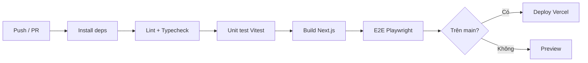

# Hướng Dẫn Triển Khai — Trạm Dừng Tâm Hồn

> Phiên bản: 1.0.0 · Cập nhật: 2026-08-30

## 1. Môi trường

| Môi trường | URL | Supabase |
|---|---|---|
| Local | `http://localhost:3000` | `npx supabase start` (Docker) hoặc Cloud |
| Staging | `staging.tramdungtamhon.com` | Project staging |
| Production | `tramdungtamhon.com` | Project production |

## 2. Triển khai lên Vercel

### 2.1 Kết nối repository

1. Import repo vào Vercel (`vercel.com/new`).
2. Framework preset: **Next.js** (tự động nhận).
3. Root directory: `/`.

### 2.2 Biến môi trường

Khai báo trong Vercel Project Settings → Environment Variables:

| Variable | Production | Staging |
|---|---|---|
| `NEXT_PUBLIC_SUPABASE_URL` | URL project prod | URL project staging |
| `NEXT_PUBLIC_SUPABASE_ANON_KEY` | anon key prod | anon key staging |
| `SUPABASE_SERVICE_ROLE_KEY` | service key prod | service key staging |
| `NEXT_PUBLIC_APP_URL` | `https://tramdungtamhon.com` | `https://staging.tramdungtamhon.com` |

> ⚠️ Không bao giờ commit secret vào git. `.env*` đã được `.gitignore`.

### 2.3 Build & Deploy hooks

- Production branch: `main`
- Preview: mọi PR khác (tự động tạo preview deployment).

## 3. Triển khai bằng Docker

```bash
# Build image
docker build -t tram-dung-tam-hon .

# Chạy với env
docker run -p 3000:3000 \
  -e NEXT_PUBLIC_SUPABASE_URL=... \
  -e NEXT_PUBLIC_SUPABASE_ANON_KEY=... \
  -e SUPABASE_SERVICE_ROLE_KEY=... \
  -e NEXT_PUBLIC_APP_URL=http://localhost:3000 \
  tram-dung-tam-hon
```

Hoặc dùng `docker-compose.yml`:

```bash
docker compose up -d
```

## 4. Database migration workflow

Mọi thay đổi DB **bắt buộc** có migration mới theo thứ tự `NNNN_ten.sql`.

```bash
# Tạo migration mới
supabase migration new ten_migration

# Local
supabase start        # khởi động stack cục bộ
supabase db reset     # reset + chạy tất cả migration + seed
supabase db push      # push migration lên remote
```

**Quy trình release DB:**
1. Tạo migration trong PR.
2. Test local với `supabase db reset`.
3. Merge → CI tự chạy `supabase db push` (hoặc thủ công sau khi merge).

## 5. Backup & Restore

Supabase tự backup (PITR trên plan paid). Để backup thủ công local:

```bash
# Script backup
./scripts/backup-db.sh
```

Restore:
```bash
supabase db restore <backup-file>
```

## 6. CI/CD (GitHub Actions — gợi ý)



## 7. Monitor & Logging

- **Vercel**: Web Analytics, Speed Insights.
- **Supabase**: Logs (Postgres, Auth, Storage) trong Dashboard; hoặc query qua `supabase query_logs`.
- **Lỗi**: Error Boundary ghi log có privacy (không log nội dung journal/mood).

## 8. Checklist pre-production

- [ ] RLS enabled, `supabase db reset` chạy sạch
- [ ] Rate limiting bật trên auth/public endpoints
- [ ] CSP/HSTS header hoạt động (kiểm tra bằng `curl -I`)
- [ ] `npm run lint` + `npm run typecheck` + `npm test` pass
- [ ] Playwright E2E smoke pass
- [ ] Docs: ARCHITECTURE / DATABASE / SECURITY / PRIVACY đã cập nhật
- [ ] Env vars đúng với environment