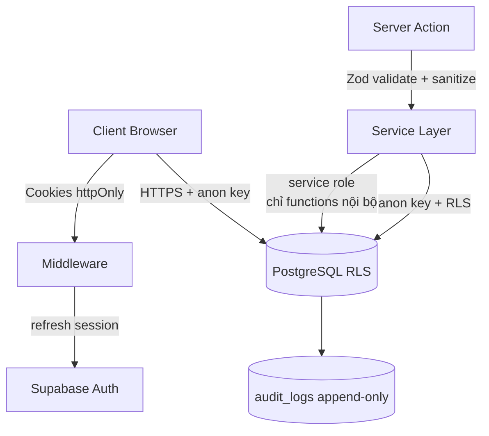

# Bảo mật — Trạm Dừng Tâm Hồn

> Phiên bản: 1.0.0 · Cập nhật: 2026-08-30
> Nguyên tắc: **Security > Privacy > UX > Performance**

## 1. Mô hình bảo mật

## 2. Phòng thủ theo lớp (Defense in depth)

1. **Transport**: HTTPS, HSTS, TLS 1.2+.
2. **HTTP Headers**: CSP, X-Frame-Options=DENY, X-Content-Type-Options=nosniff, Referrer-Policy (xem `next.config.ts` + `src/lib/security/headers.ts`).
3. **Input validation**: Zod schemas ở mọi ngõ vào (`src/schemas/*`, `src/lib/validation/*`).
4. **Output sanitization**: `escapeHtml`, `stripHtml`, `sanitizeUrl` chống XSS (`src/lib/security/sanitize.ts`).
5. **RLS**: mọi bảng bật RLS, policy theo `auth.uid()`.
6. **Least privilege**: anon key cho client; `SUPABASE_SERVICE_ROLE_KEY` chỉ trên server, không bao giờ `NEXT_PUBLIC_`.
7. **Audit**: truy cập dữ liệu CLINICAL/SENSITIVE luôn ghi `audit_logs` (append-only).
8. **Rate limiting**: auth 10 req/phút, public 60 req/phút (`src/constants/validation.ts`).

## 3. Authentication & Session

- JWT session 3600s + refresh token rotation (Supabase).
- Refresh qua Edge Middleware (`src/middleware.ts`) để cookie luôn hợp lệ.
- Bảo vệ route: `PROTECTED_ROUTES` redirect về `/login` nếu chưa xác thực.

## 4. Xử lý nhạy cảm

- Không log nội dung journal/mood/notes vào service logs; chỉ log metadata vào audit.
- Email confirm & reset password dùng link có token một lần.
- User-agent/IP được lưu trong `consents` để truy vết (không hiển thị UI).

## 5. Rate limiting chi tiết

| Nhóm | Giới hạn | Ghi chú |
|---|---|---|
| Auth (login/register/reset) | 10 req/phút | `/login`, `/register`, `/forgot-password` |
| Public endpoints | 60 req/phút | Story feed, knowledge |
| API mutations | 120 req/phút | Server Actions |

## 6. Checklist bảo mật khi code

- [ ] Mọi input từ client đều qua Zod schema.
- [ ] React không dùng `dangerouslySetInnerHTML` với dữ liệu user (nếu cần → sanitize trước).
- [ ] Không import `server-only` secrets vào Client Components.
- [ ] Không thêm bảng mới mà quên RLS (bật mặc định).
- [ ] Access log cho mọi quyền cấp/thu hồi.
- [ ] Không hard-code secret; dùng `.env.local` (đã gitignore).